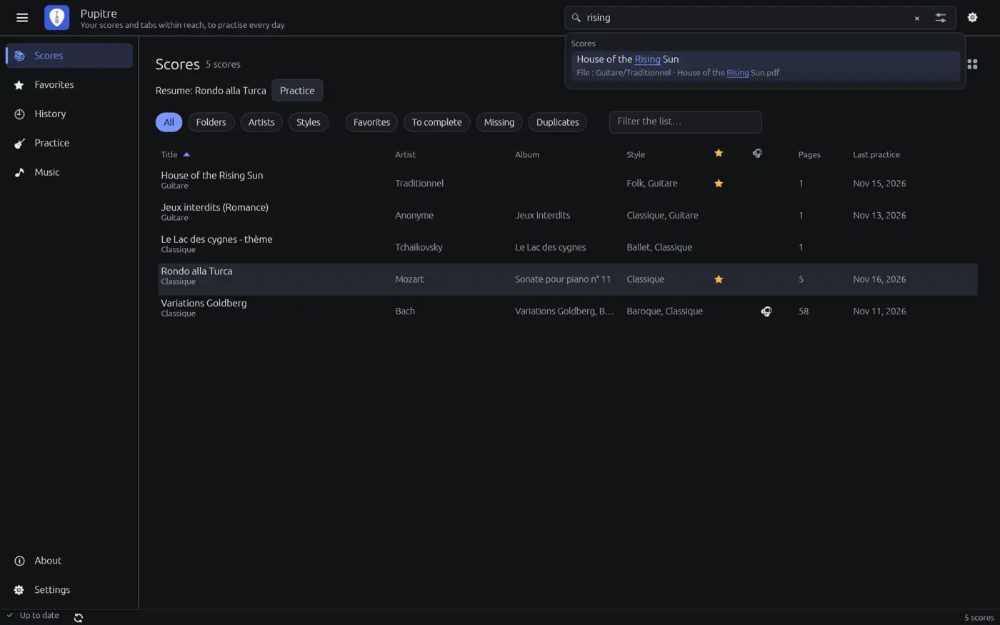
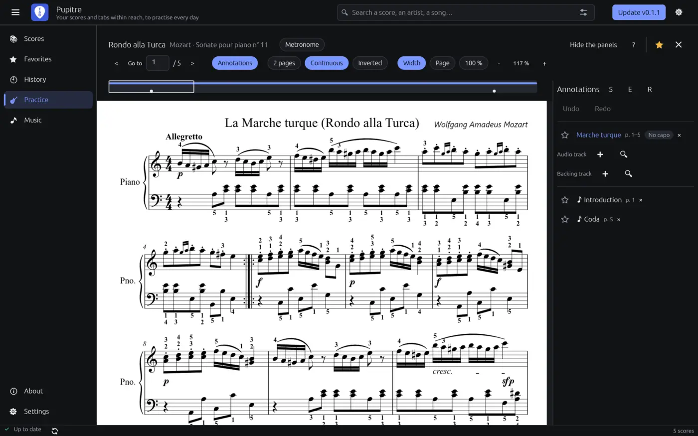
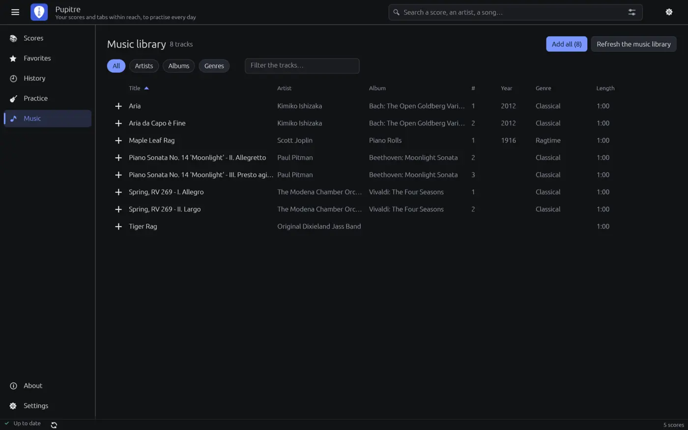
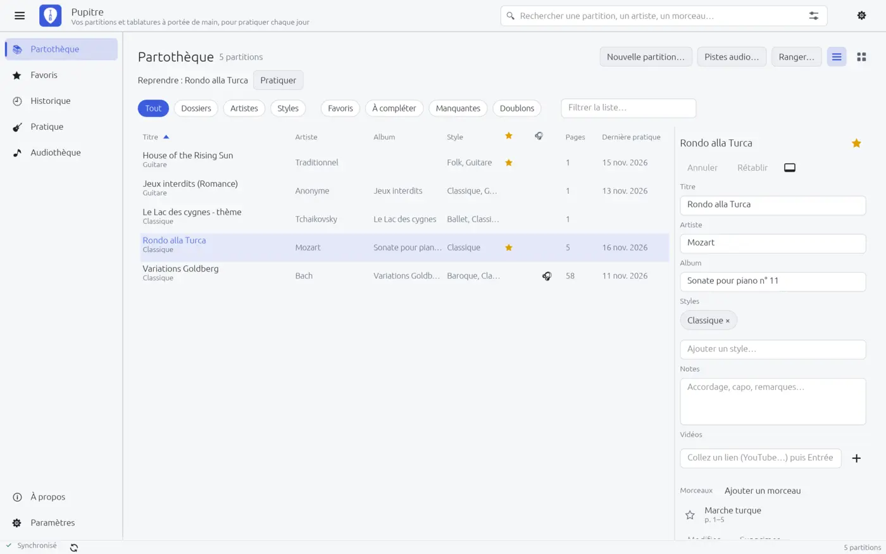
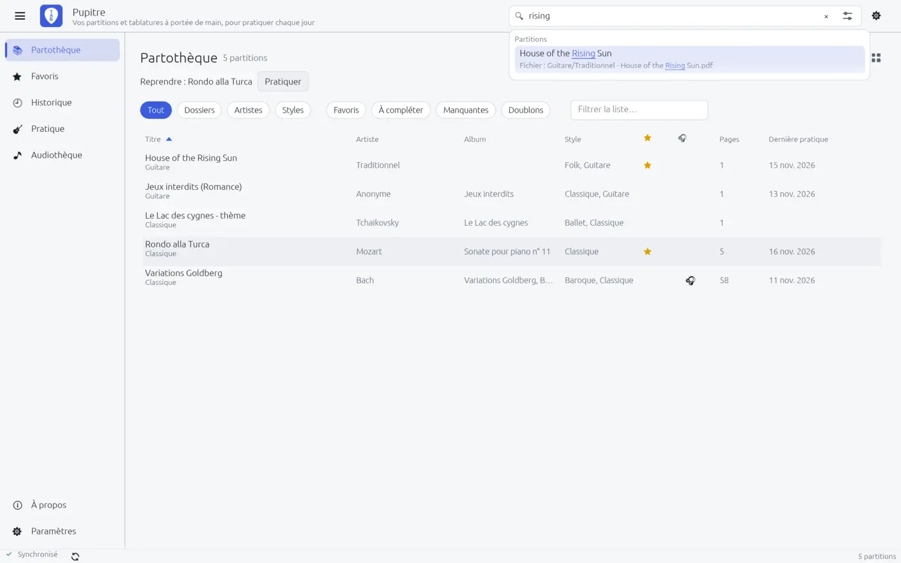
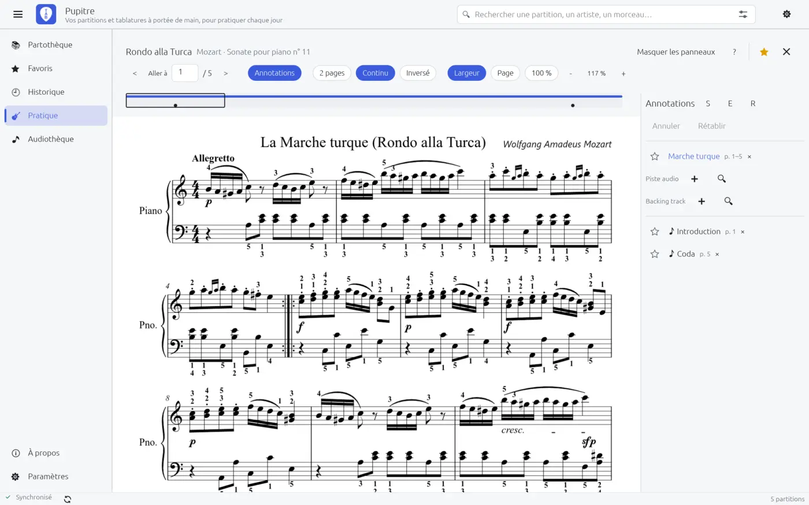
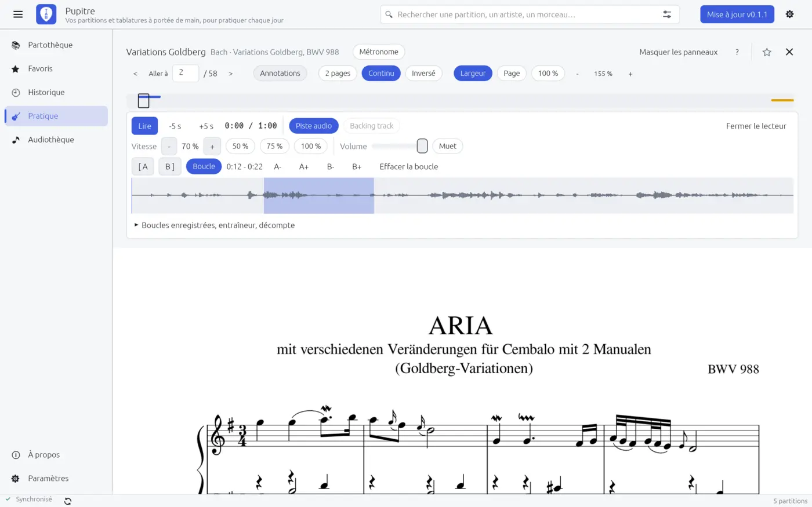
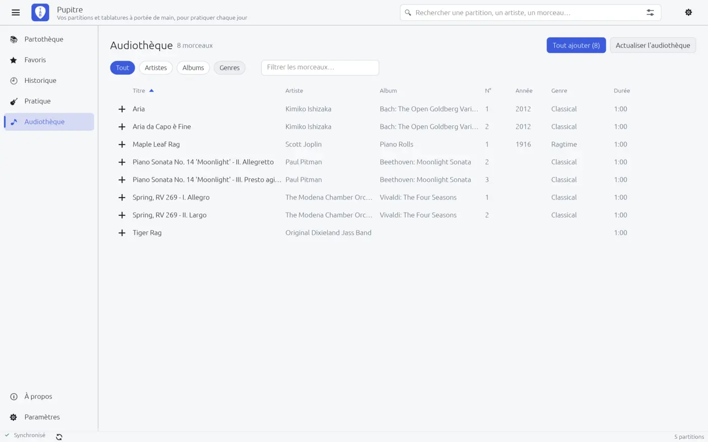

# Pupitre

[English](#english) · [Français](#français)

## English

**Pupitre** — Your scores and tabs within reach, to practise every day

**Version 0.1.0** — [Download](https://github.com/jerome-jouvie/pupitre-releases/releases/tag/v0.1.0)

### About

Pupitre is the must-have desktop app for musicians buried under scores and tabs in PDF or image form. It turns your folders into a truly smart music library and into the ideal digital music stand for rehearsing.

- **Your folder, organised at last**: Pupitre indexes your existing library and automatically detects artists, albums and titles from your file names. Each score can be split into songs (with pages and capo), enriched with riffs and styles, and added to your favourites.
- **Found in a second**: A lightning-fast universal search box (forgiving of typos and accents) indexes titles, artists and riffs. A single click on a result instantly opens the score at the exact page.
- **Practice without distraction**: Enjoy a full-screen viewer that remembers where you left off. Turn pages with the keyboard, a pedal or a click, and mark your songs and riffs mid-play in just two keystrokes.
- **Play along with the recording**: Attach a full song or a backing track to your scores. Adjust the playback speed from 25% to 150% without changing the pitch, loop a passage (A–B) using the waveform, and make the most of the built-in speed trainer.
- **Your music too**: The music library explores your audio files by artist, album and genre, with cover art and play queues.
- **Follow your progress**: Your practice sessions are timed automatically. Find your history, detailed statistics and favourites at a glance.
- **Your files belong to you**: Everything runs locally on your computer, with no account and no telemetry. Your original files are respected: the smart tidying mode renames your files safely, with a preview and undo.

Available in English and French, with a light and a dark theme, Pupitre runs on Linux, Windows and macOS.

### Screenshots

<table>
  <tr>
    <td width="50%" valign="top">
       
      The score library: all your scores and tabs, sorted and filtered
    </td>
    <td width="50%" valign="top">
       
      The details of a score: metadata, songs, audio tracks
    </td>
  </tr>
  <tr>
    <td width="50%" valign="top">
       
      The global search (titles, artists, songs, riffs)
    </td>
    <td width="50%" valign="top">
       
      The practice viewer
    </td>
  </tr>
  <tr>
    <td width="50%" valign="top">
       
      Annotations: songs and riffs set on the score
    </td>
    <td width="50%" valign="top">
       
      The audio player: slow-down without changing the pitch, A–B loop, waveform
    </td>
  </tr>
  <tr>
    <td width="50%" valign="top">
       
      The music library: your music, tags read from the files
    </td>
    <td width="50%" valign="top">
       
      The play queue and the player, with the listening indicator in the menu
    </td>
  </tr>
</table>

### Changelog

#### 0.1.0 - 2026-11-15

**Features**

- **Scores library**: browse your folder of scores and tabs (PDF and images), with a sheet for each
  score (artist, album, songs, riffs, styles, favourite), and for each song the fret of its capo.
  The folder is watched: files you add, rename or move outside the application are picked up, and
  renamed files are recognised.
- **Instant search** across your scores and songs, with filters (artist, style, favourite…),
  suggestions as you type, "did you mean" and recent searches. The filter of the scores list and the
  search also find a score by the title of one of its songs.
- **Practice viewer**: full-screen reading with page turning by keyboard, pedal or click, zoom and
  fit, collapsible panels, light-on-dark inversion, your position remembered for each score and
  your choice between fitting the width or the whole page remembered for all of them. A badge tells
  you when a capo is needed on the page you are reading, and on which fret.
- **Practice sessions and annotations**: sessions are timed and recovered after a crash; mark songs
  and riffs, favourites and notes while you play, in two interactions at most.
- **Audio while you practise**: link a full recording or a backing track to each song; slow it down
  from 25 % to 150 % with the pitch preserved, loop a section (A–B) without a gap, save named
  loops, use the speed trainer and the count-in, and see the waveform.
- **Music library** (Audiothèque): browse your music folder by artist, album and genre, with covers
  that enlarge when you point at them, and a playlist with shuffle and repeat modes, a volume
  control, the playback keys (space, ← →) and a size you can adjust. The music keeps playing when
  you close the window (notification area on Linux). While you practise, the playlist only shows
  when a track is playing, so the score has all the room.
- **Videos on a score**: attach links (YouTube…) to a score and open them in your browser.
- **Create a PDF from images**: assemble screenshots or scans into a score, several images per page
  if you wish.
- **Fill in sheets from file names**: artist, album and title are suggested from the names of your
  files, which you accept, adjust or ignore.
- **Tidy up your folder**: rename and move files by a template, with a preview, exclusions and an
  undo. Your files are never modified or copied.
- **Favourites, history and statistics** of your practice.
- **Online lookup of music information** (off by default, one click, only the title and the artist
  are sent).
- **Comfortable layout**: a details panel you can resize and dock on the right or at the bottom, and
  a navigation rail you can collapse.
- **Backups and portability**: database backup, export and import of your data (JSON), thumbnails
  maintenance and complete settings.
- **Updates**: Pupitre looks for a newer version once a day (you can turn it off) and offers a
  button to update; nothing is downloaded without your click.
- **Languages and looks**: French and English, light and dark themes, adjustable interface size,
  keyboard navigation everywhere, and an accessibility review.
- **Linux, Windows and macOS**: a package for Linux (.deb) and a stand-alone program; installer
  (MSI) and portable program for Windows (x64 and arm64); an application for macOS (Intel and
  Apple Silicon). The Windows and macOS builds have not yet been tried on those systems.

## Français

**Pupitre** — Vos partitions et tablatures à portée de main, pour pratiquer chaque jour

**Version 0.1.0** — [Télécharger](https://github.com/jerome-jouvie/pupitre-releases/releases/tag/v0.1.0)

### Présentation

Pupitre est l'application de bureau indispensable pour les musiciens qui croulent sous les partitions et tablatures en PDF ou en images. Elle transforme vos dossiers en une véritable bibliothèque musicale intelligente et en un pupitre numérique idéal pour répéter.

- **Votre dossier, enfin organisé** : Pupitre indexe votre bibliothèque existante et détecte automatiquement les artistes, albums et titres à partir du nom de vos fichiers. Chaque partition peut être découpée en morceaux (avec pages et capodastre), enrichie de riffs, de styles et ajoutée à vos favoris.
- **Retrouvée en une seconde** : Un champ de recherche universel ultra-rapide (tolérant aux fautes de frappe et aux accents) indexe titres, artistes et riffs. Un simple clic sur un résultat ouvre instantanément la partition à la page exacte.
- **Pratiquer sans distraction** : Profitez d'une visionneuse en plein écran avec mémorisation de votre position de lecture. Tournez les pages au clavier, à la pédale ou au clic, et marquez vos morceaux et riffs en plein jeu en seulement deux touches.
- **Jouer avec l'enregistrement** : Associez un morceau complet ou un backing track à vos partitions. Ajustez la vitesse de lecture de 25 % à 150 % sans altérer la hauteur de note, bouclez un passage (A–B) à l'aide de la forme d'onde et profitez de l'entraîneur de vitesse intégré.
- **Votre musique aussi** : L'audiothèque explore vos fichiers audio par artiste, album et genre, avec affichage des pochettes et gestion de listes de lecture.
- **Suivre vos progrès** : Vos sessions de pratique sont chronométrées automatiquement. Retrouvez votre historique, vos statistiques détaillées et vos favoris en un clin d'œil.
- **Vos fichiers vous appartiennent** : Tout fonctionne localement sur votre ordinateur, sans création de compte ni télémétrie. Vos fichiers originaux sont respectés : le mode de rangement intelligent renomme vos fichiers en toute sécurité avec un système d'aperçu et d'annulation.

Disponible en français et en anglais, avec un thème clair et un thème sombre, Pupitre est compatible sous Linux, Windows et macOS.

### Captures d'écran

<table>
  <tr>
    <td width="50%" valign="top">
       
      La partothèque : toutes vos partitions et tablatures, triées et filtrées
    </td>
    <td width="50%" valign="top">
       
      Le détail d'une partition : métadonnées, morceaux, pistes audio
    </td>
  </tr>
  <tr>
    <td width="50%" valign="top">
       
      La recherche globale (titres, artistes, morceaux, riffs)
    </td>
    <td width="50%" valign="top">
       
      La visionneuse de pratique
    </td>
  </tr>
  <tr>
    <td width="50%" valign="top">
       
      Les annotations : morceaux et riffs posés sur la partition
    </td>
    <td width="50%" valign="top">
       
      Le lecteur audio : ralentissement sans changer la hauteur, boucle A–B, forme d'onde
    </td>
  </tr>
  <tr>
    <td width="50%" valign="top">
       
      L'Audiothèque : votre musique, étiquettes lues dans les fichiers
    </td>
    <td width="50%" valign="top">
       
      La liste de lecture et le lecteur, avec l'indicateur d'écoute dans le menu
    </td>
  </tr>
</table>

### Journal des changements

#### 0.1.0 - 2026-11-15

**Fonctionnalités**

- **Partothèque** : parcourez votre dossier de partitions et de tablatures (PDF et images), avec une
  fiche par partition (artiste, album, morceaux, riffs, styles, favori), et pour chaque morceau la
  case de son capodastre. Le dossier est surveillé : les fichiers ajoutés, renommés ou déplacés hors
  de l'application sont pris en compte, et les fichiers renommés sont retrouvés.
- **Recherche instantanée** dans vos partitions et morceaux, avec des filtres (artiste, style,
  favori…), des suggestions à la frappe, « vouliez-vous dire » et les recherches récentes. Le filtre
  de la liste des partitions et la recherche trouvent aussi une partition par le titre d'un de ses
  morceaux.
- **Visionneuse de pratique** : lecture plein écran avec changement de page au clavier, à la pédale ou
  au clic, zoom et ajustement, panneaux repliables, inversion clair/sombre, votre position mémorisée
  pour chaque partition et votre choix entre ajuster à la largeur ou à la page retenu pour toutes.
  Un badge indique quand un capodastre est nécessaire sur la page lue, et sur quelle case.
- **Sessions de pratique et annotations** : les sessions sont chronométrées et récupérées après un
  plantage ; marquez morceaux, riffs, favoris et notes pendant que vous jouez, en deux interactions
  au plus.
- **Audio pendant la pratique** : liez un enregistrement complet ou un backing track à chaque morceau ;
  ralentissez de 25 % à 150 % sans changer la hauteur, bouclez un passage (A–B) sans coupure,
  enregistrez des boucles nommées, utilisez l'entraîneur de vitesse et le décompte, et voyez la forme
  d'onde.
- **Audiothèque** : parcourez votre dossier de musique par artiste, album et genre, avec des pochettes
  qui s'agrandissent quand on les survole, et une liste de lecture avec lecture aléatoire et
  répétition, un réglage du volume, les touches de lecture (espace, ← →) et une taille ajustable. La
  musique continue de jouer quand on ferme la fenêtre (zone de notification sous Linux). Pendant la
  pratique, la liste de lecture n'apparaît que lorsqu'un morceau joue : la partition a toute la place.
- **Vidéos d'une partition** : rattachez des liens (YouTube…) à une partition et ouvrez-les dans votre
  navigateur.
- **Création d'un PDF depuis des images** : assemblez des captures ou des scans en une partition,
  plusieurs images par page si vous le souhaitez.
- **Fiches pré-remplies depuis les noms de fichiers** : artiste, album et titre sont proposés d'après
  le nom de vos fichiers, que vous acceptez, ajustez ou ignorez.
- **Rangement du dossier** : renommez et déplacez les fichiers selon un gabarit, avec aperçu,
  exclusions et annulation. Vos fichiers ne sont jamais modifiés ni copiés.
- **Favoris, historique et statistiques** de votre pratique.
- **Recherche en ligne d'informations musicales** (désactivée par défaut, sur un clic, seuls le titre
  et l'artiste sont envoyés).
- **Disposition confortable** : un panneau de détails redimensionnable et ancrable à droite ou en
  bas, et un rail de navigation repliable.
- **Sauvegardes et portabilité** : sauvegarde de la base, export et import de vos données (JSON),
  maintenance des miniatures et réglages complets.
- **Mises à jour** : Pupitre cherche une version plus récente une fois par jour (désactivable) et
  propose un bouton de mise à jour ; rien n'est téléchargé sans votre clic.
- **Langues et apparence** : français et anglais, thèmes clair et sombre, taille d'interface
  réglable, navigation complète au clavier, et une revue d'accessibilité.
- **Linux, Windows et macOS** : un paquet pour Linux (.deb) et un programme autonome ; un installeur
  (MSI) et un programme portable pour Windows (x64 et arm64) ; une application pour macOS (Intel et
  Apple Silicon). Les versions Windows et macOS n'ont pas encore été essayées sur ces systèmes.
