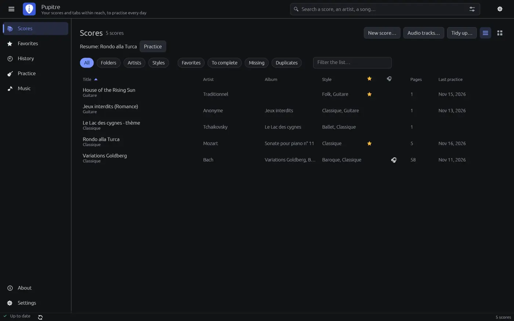
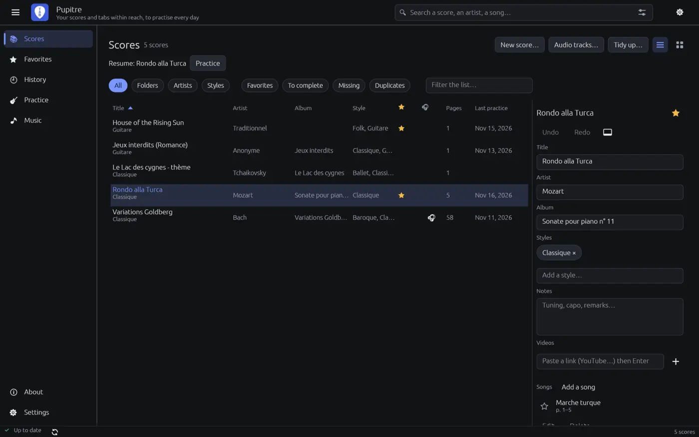
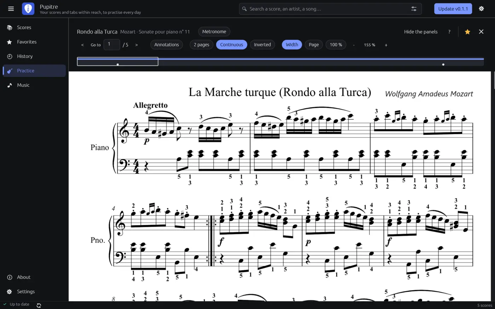
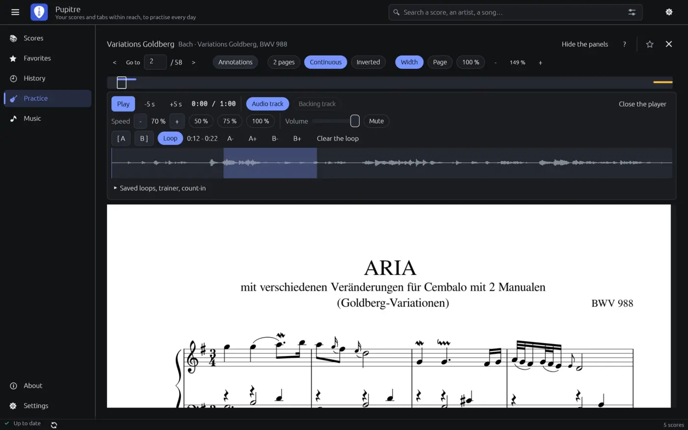
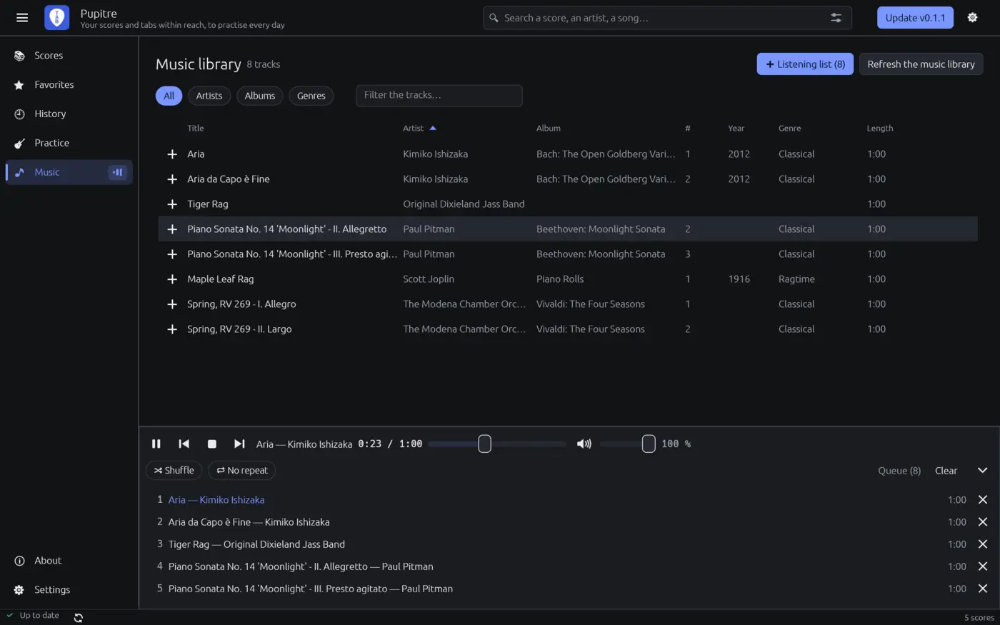
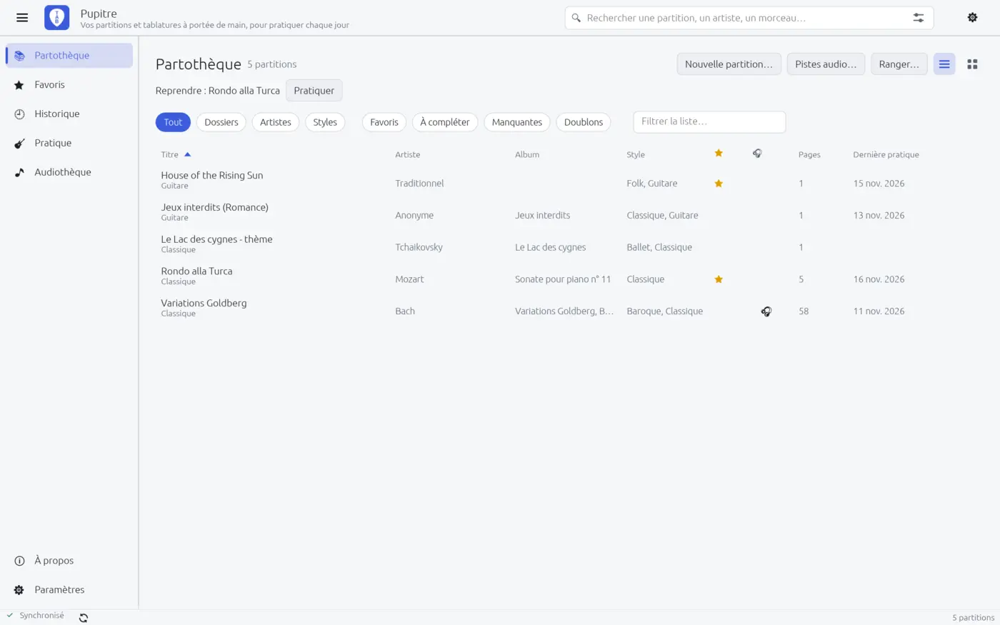
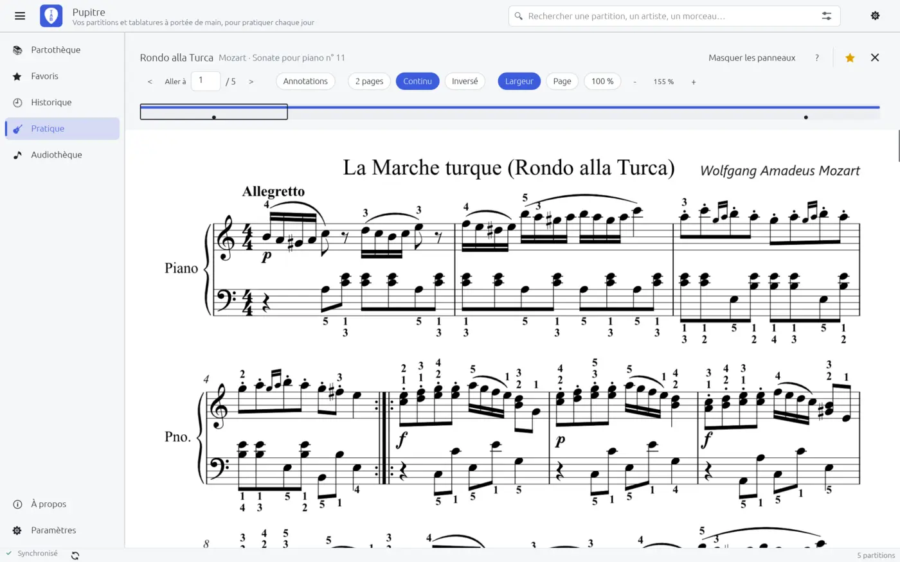
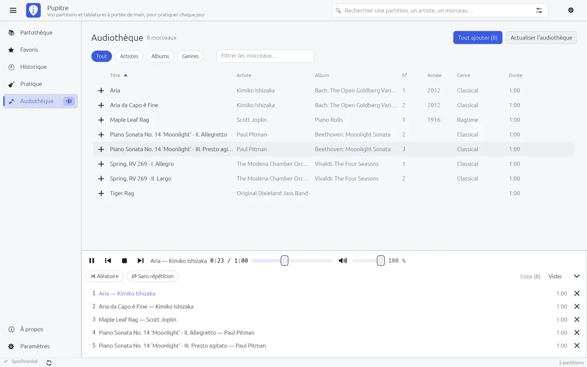

# Pupitre

[English](#english) · [Français](#français)

## English

**Pupitre** — Your scores and tabs within reach, to practise every day

**Version 0.2.0** — [Download](https://github.com/jerome-jouvie/pupitre-releases/releases/tag/v0.2.0)

### About

Pupitre is the must-have desktop app for musicians buried under scores and tabs in PDF or image form. It turns your folders into a truly smart music library and into the ideal digital music stand for rehearsing.

- **Your folder, organised at last**: Pupitre indexes your existing library and automatically detects artists, albums and titles from your file names. Each score can be split into songs (with pages and capo), enriched with riffs and styles, and added to your favourites.
- **Found in a second**: A lightning-fast universal search box (forgiving of typos and accents) indexes titles, artists and riffs. A single click on a result instantly opens the score at the exact page.
- **Practice without distraction**: Enjoy a full-screen viewer that remembers where you left off. Turn pages with the keyboard, a pedal or a click, and mark your songs and riffs mid-play in just two keystrokes.
- **Play along with the recording**: Attach a full song or a backing track to your scores. Adjust the playback speed from 25% to 150% without changing the pitch, loop a passage (A–B) using the waveform, and make the most of the built-in speed trainer.
- **Your music too**: The music library explores your audio files by artist, album and genre, with cover art and play queues.
- **Follow your progress**: Your practice sessions are timed automatically. Find your history, detailed statistics and favourites at a glance.
- **Your files belong to you**: Everything runs locally on your computer, with no account and no telemetry. Your original files are respected: the smart tidying mode renames your files safely, with a preview and undo.

Available in English and French, with a light and a dark theme, Pupitre runs on Linux, Windows and macOS.

### Screenshots

<table>
  <tr>
    <td width="50%" valign="top">
       
      The score library: all your scores and tabs, sorted and filtered
    </td>
    <td width="50%" valign="top">
       
      The details of a score: metadata, songs, audio tracks
    </td>
  </tr>
  <tr>
    <td width="50%" valign="top">
       
      The global search (titles, artists, songs, riffs)
    </td>
    <td width="50%" valign="top">
       
      The practice viewer
    </td>
  </tr>
  <tr>
    <td width="50%" valign="top">
       
      Annotations: songs and riffs set on the score
    </td>
    <td width="50%" valign="top">
       
      The audio player: slow-down without changing the pitch, A–B loop, waveform
    </td>
  </tr>
  <tr>
    <td width="50%" valign="top">
       
      The music library: your music, tags read from the files
    </td>
    <td width="50%" valign="top">
       
      The play queue and the player, with the listening indicator in the menu
    </td>
  </tr>
</table>

### Changelog

#### 0.2.0 - 2026-11-20

**Features**

- Distribution: Pupitre now comes as a `.deb`, `.rpm`, AppImage, `.tar.gz` (with a per-user `install.sh`) and Flatpak on Linux, an installer, a program and a portable archive on Windows, and an application on macOS. A `portable.txt` file next to the program keeps all its data beside it. The tray icon (with its menu to control the playlist) now exists on Windows and macOS too.
- Updates: Pupitre recognises how it was installed (Debian or RPM package, AppImage, portable program, MSI, macOS app, Flatpak…), picks the right file of the new version for your system and processor, and updates itself the right way: the system installer, `msiexec`, or replacing its own file, then offering to restart. A program that replaces itself only accepts a file signed by the author and newer than the running one; the old version stays untouched if anything fails. With Flatpak, it tells you to update with Flatpak.
- Practice: a metronome (`K`) next to the title: tempo from 30 to 300, tap tempo (`T`), 1 to 12 beats per bar with the first accented, volume, beat lights; it plays along with the audio track and remembers your settings.
- Music Library: edit a track's metadata (title, artist, album, album artist, genre, number, year, publisher) and save it to the file, once writing tags is allowed in Settings (off by default, with a confirmation). Only the changed fields are written, the audio is never touched, and "Undo" restores the original tags.
- Music Library: edit the shared metadata of several tracks at once (artist, album, genre, year, publisher…); identical values are prefilled, each changed field can be reset, and the title and track number stay specific to each track.
- Music Library: after choosing an album edition, you pick each file's track (or leave it alone), the fields taken (current and proposed values side by side) and the edition's cover; "Undo" puts the previous cover back.
- Music Library: look metadata up on MusicBrainz by title (one track) or by album name (several tracks of the same album), with an editable search text; the chosen result or edition is prepared, then written only when you click "Save".
- Updates: once the new version is installed, a message and a "Restart" button in the top bar open it in place of the old one.
- Scores Library and Music Library: a cross at the top right closes the details panel, including for a multiple selection.

**Improvements**

- Each song's capo is now in sight, at its right, in the song list and in the Annotations panel ("Capo 2" or "No capo"): two clicks set, change or remove it.
- Practice: the Up and Down arrows scroll three quarters of a screen (one page at most) instead of a few lines.
- Online search: MusicBrainz and the Cover Art Archive are contacted in the name of the program's author, as they ask: the "Contact" setting is gone; the settings show the identification sent, with an (i) button that explains it.
- "About" shows the author, Jérôme Jouvie, and their address.
- Scores Library and Music Library: an artist written "A, B; C" appears under each of the three names when grouping by artist.
- Scores Library and Music Library: the chosen grouping (Folders, Artists, Albums, Genres, Styles) shows a "×": a click on it deselects it.
- Music Library: the sorted column is kept when you filter on an album, an artist or a genre (opening an album no longer puts the track-number order back); the default order is artist, then album and track number, and a click on "All" restores it (not when "All" becomes active through another action).
- Music Library: in the browsing panel, "All" becomes "All tracks".
- Music Library: a single button, "Listening list (n)", adds the selection to the playlist, or every track shown when nothing is selected.
- Music Library: reorganised details panel: "Listen" with the headphones icon, then the metadata (and their editing), the online search and the file information; the duplicate add-to-playlist button is gone.
- Windows and macOS: the program shows its copyright (© 2026 Jérôme Jouvie) in its properties and its About window.

**Fixes**

- Practice: a very tall image (a long tab, for instance) shown at full width no longer crashes the application.
- Online search: while MusicBrainz is unavailable, the buttons that would send a request are greyed out (with the reason and the time left) and come back by themselves when the wait is over; messages are shorter ("MusicBrainz is overloaded (global zone). Wait 1 min before trying again.").
- Online search: one request at a time, at least a second apart. If MusicBrainz does not answer (or returns a 502), the application says so and pauses searches for 5 minutes; if it is overloaded (error 503), it tries twice more, 5 seconds apart, then explains the overload and pauses searches for 1 minute. When MusicBrainz states its limit (`Retry-After` and `X-RateLimit-…` headers), the application follows it instead of its own delays: no new attempt when the servers are overloaded (global zone), a new attempt after the delay given when it is your address that is limited. The request details show each attempt and the `X-…` headers of the answer.
- Online search: copying the request details now copies the whole response, not just its beginning.
- Linux: the .deb package names its real maintainer instead of an example address.
- Windows and macOS: the update window no longer offers to download the Linux package (which could not be installed); it explains that the update is done by hand from the release page.

#### 0.1.1 - 2026-11-16

**Features**

- Launching Pupitre again no longer starts a second copy: the window of the one already running comes back to the front, even from the notification area.

**Improvements**

- In the scores library and the music library, clicking the grouping already chosen (Folders, Artists, Albums, Genres, Styles) takes it away and shows everything again.
- The "Edit" screen is gone: it repeated the details panel, which now ends with the file's information (path, size, pages, date added, practice time). A score created from images is selected, with its details shown.
- Looking for a song's audio file also finds names whose words are stuck together, such as "01 MediterraneanSundanceRioAncho" for "Mediterranean Sundance".
- The playlist scrolls to the track that starts playing when it is out of view; scroll elsewhere and it stays put until the next track.
- The menu of the notification-area icon sets the volume (from 0 to 100 %) and mutes the sound; the mouse wheel on the icon turns the volume up or down.
- Windows: the program and the installer name their publisher, Jérôme Jouvie, and "Installed apps" links to the Pupitre releases page.
- The About screen describes Pupitre for any instrument, no longer for guitar, bass and piano only.
- In practice, double-click the pages to hide or show the panels (in page mode, in the middle of the page: the sides still turn pages).
- The viewer's shortcut help is grouped by topic on two columns, describes the mouse too, and fits on the screen.
- In practice, the score's pages now reach the edges of the reading area, with the panels shown or hidden: no more border around them.

**Fixes**

- The playlist no longer stops at the end of a track when the window is minimised.
- After linking audio tracks to your songs ("Audio tracks…"), the scores library shows them at once, without restarting.
- After tidying up, the preview no longer claims that the new names are already taken and offers to number them: the files were renamed correctly.
- Windows: the installer (MSI) opens Pupitre once it has finished; it has no window of its own, so nothing showed that the installation had worked. Uninstalling no longer leaves an empty folder behind.

#### 0.1.0 - 2026-11-15

**Features**

- **Scores library**: browse your folder of scores and tabs (PDF and images), with a sheet for each
  score (artist, album, songs, riffs, styles, favourite), and for each song the fret of its capo.
  The folder is watched: files you add, rename or move outside the application are picked up, and
  renamed files are recognised.
- **Instant search** across your scores and songs, with filters (artist, style, favourite…),
  suggestions as you type, "did you mean" and recent searches. The filter of the scores list and the
  search also find a score by the title of one of its songs.
- **Practice viewer**: full-screen reading with page turning by keyboard, pedal or click, zoom and
  fit, collapsible panels, light-on-dark inversion, your position remembered for each score and
  your choice between fitting the width or the whole page remembered for all of them. A badge tells
  you when a capo is needed on the page you are reading, and on which fret.
- **Practice sessions and annotations**: sessions are timed and recovered after a crash; mark songs
  and riffs, favourites and notes while you play, in two interactions at most.
- **Audio while you practise**: link a full recording or a backing track to each song; slow it down
  from 25 % to 150 % with the pitch preserved, loop a section (A–B) without a gap, save named
  loops, use the speed trainer and the count-in, and see the waveform.
- **Music library** (Audiothèque): browse your music folder by artist, album and genre, with covers
  that enlarge when you point at them, and a playlist with shuffle and repeat modes, a volume
  control, the playback keys (space, ← →) and a size you can adjust. The music keeps playing when
  you close the window (notification area on Linux). While you practise, the playlist only shows
  when a track is playing, so the score has all the room.
- **Videos on a score**: attach links (YouTube…) to a score and open them in your browser.
- **Create a PDF from images**: assemble screenshots or scans into a score, several images per page
  if you wish.
- **Fill in sheets from file names**: artist, album and title are suggested from the names of your
  files, which you accept, adjust or ignore.
- **Tidy up your folder**: rename and move files by a template, with a preview, exclusions and an
  undo. Your files are never modified or copied.
- **Favourites, history and statistics** of your practice.
- **Online lookup of music information** (off by default, one click, only the title and the artist
  are sent).
- **Comfortable layout**: a details panel you can resize and dock on the right or at the bottom, and
  a navigation rail you can collapse.
- **Backups and portability**: database backup, export and import of your data (JSON), thumbnails
  maintenance and complete settings.
- **Updates**: Pupitre looks for a newer version once a day (you can turn it off) and offers a
  button to update; nothing is downloaded without your click.
- **Languages and looks**: French and English, light and dark themes, adjustable interface size,
  keyboard navigation everywhere, and an accessibility review.
- **Linux, Windows and macOS**: a package for Linux (.deb) and a stand-alone program; installer
  (MSI) and portable program for Windows (x64 and arm64); an application for macOS (Intel and
  Apple Silicon). The Windows and macOS builds have not yet been tried on those systems.

## Français

**Pupitre** — Vos partitions et tablatures à portée de main, pour pratiquer chaque jour

**Version 0.2.0** — [Télécharger](https://github.com/jerome-jouvie/pupitre-releases/releases/tag/v0.2.0)

### Présentation

Pupitre est l'application de bureau indispensable pour les musiciens qui croulent sous les partitions et tablatures en PDF ou en images. Elle transforme vos dossiers en une véritable bibliothèque musicale intelligente et en un pupitre numérique idéal pour répéter.

- **Votre dossier, enfin organisé** : Pupitre indexe votre bibliothèque existante et détecte automatiquement les artistes, albums et titres à partir du nom de vos fichiers. Chaque partition peut être découpée en morceaux (avec pages et capodastre), enrichie de riffs, de styles et ajoutée à vos favoris.
- **Retrouvée en une seconde** : Un champ de recherche universel ultra-rapide (tolérant aux fautes de frappe et aux accents) indexe titres, artistes et riffs. Un simple clic sur un résultat ouvre instantanément la partition à la page exacte.
- **Pratiquer sans distraction** : Profitez d'une visionneuse en plein écran avec mémorisation de votre position de lecture. Tournez les pages au clavier, à la pédale ou au clic, et marquez vos morceaux et riffs en plein jeu en seulement deux touches.
- **Jouer avec l'enregistrement** : Associez un morceau complet ou un backing track à vos partitions. Ajustez la vitesse de lecture de 25 % à 150 % sans altérer la hauteur de note, bouclez un passage (A–B) à l'aide de la forme d'onde et profitez de l'entraîneur de vitesse intégré.
- **Votre musique aussi** : L'audiothèque explore vos fichiers audio par artiste, album et genre, avec affichage des pochettes et gestion de listes de lecture.
- **Suivre vos progrès** : Vos sessions de pratique sont chronométrées automatiquement. Retrouvez votre historique, vos statistiques détaillées et vos favoris en un clin d'œil.
- **Vos fichiers vous appartiennent** : Tout fonctionne localement sur votre ordinateur, sans création de compte ni télémétrie. Vos fichiers originaux sont respectés : le mode de rangement intelligent renomme vos fichiers en toute sécurité avec un système d'aperçu et d'annulation.

Disponible en français et en anglais, avec un thème clair et un thème sombre, Pupitre est compatible sous Linux, Windows et macOS.

### Captures d'écran

<table>
  <tr>
    <td width="50%" valign="top">
       
      La partothèque : toutes vos partitions et tablatures, triées et filtrées
    </td>
    <td width="50%" valign="top">
       
      Le détail d'une partition : métadonnées, morceaux, pistes audio
    </td>
  </tr>
  <tr>
    <td width="50%" valign="top">
       
      La recherche globale (titres, artistes, morceaux, riffs)
    </td>
    <td width="50%" valign="top">
       
      La visionneuse de pratique
    </td>
  </tr>
  <tr>
    <td width="50%" valign="top">
       
      Les annotations : morceaux et riffs posés sur la partition
    </td>
    <td width="50%" valign="top">
       
      Le lecteur audio : ralentissement sans changer la hauteur, boucle A–B, forme d'onde
    </td>
  </tr>
  <tr>
    <td width="50%" valign="top">
       
      L'Audiothèque : votre musique, étiquettes lues dans les fichiers
    </td>
    <td width="50%" valign="top">
       
      La liste de lecture et le lecteur, avec l'indicateur d'écoute dans le menu
    </td>
  </tr>
</table>

### Journal des changements

#### 0.2.0 - 2026-11-20

**Fonctionnalités**

- Distribution : Pupitre est proposé en `.deb`, `.rpm`, AppImage, `.tar.gz` (avec un `install.sh` par utilisateur) et Flatpak sous Linux, en installeur, programme seul et archive portable sous Windows, et en application sous macOS. Un fichier `portable.txt` à côté du programme garde toutes ses données à côté de lui. L'icône de la zone de notification (et son menu de contrôle de la liste de lecture) existe aussi sous Windows et macOS.
- Mise à jour : Pupitre reconnaît comment il a été installé (paquet Debian ou RPM, AppImage, programme portable, MSI, application macOS, Flatpak…), choisit le bon fichier de la nouvelle version pour votre système et votre processeur et se met à jour de la bonne manière : installeur du système, `msiexec`, ou remplacement de son propre fichier puis proposition de redémarrer. Un programme qui se remplace lui-même n'accepte qu'un fichier signé par l'auteur et plus récent que celui qui tourne ; l'ancienne version reste intacte en cas d'échec. Avec Flatpak, il indique de passer par Flatpak.
- Pratique : un métronome (`K`) à côté du titre : tempo de 30 à 300, tempo tapé (`T`), 1 à 12 temps par mesure avec le premier accentué, volume, voyants des temps ; il joue en même temps que la piste audio et retient vos réglages.
- Audiothèque : modifier les métadonnées d'un morceau (titre, artiste, album, artiste de l'album, genre, numéro, année, éditeur) et les enregistrer dans le fichier, une fois l'écriture des étiquettes autorisée dans les Réglages (désactivée par défaut, avec confirmation). Seuls les champs modifiés sont écrits, le son n'est jamais touché et « Annuler » rétablit les étiquettes d'origine.
- Audiothèque : modifier en une fois les métadonnées communes de plusieurs morceaux (artiste, album, genre, année, éditeur…) ; les valeurs identiques sont préremplies, chaque champ modifié peut être rétabli, le titre et le numéro de piste restent propres à chaque morceau.
- Audiothèque : après le choix d'une édition d'album, vous choisissez la piste de chaque fichier (ou de ne pas le modifier), les champs repris (valeurs actuelles et proposées côte à côte) et la pochette de l'édition ; « Annuler » remet l'ancienne pochette.
- Audiothèque : chercher les métadonnées sur MusicBrainz par titre (un morceau) ou par nom d'album (plusieurs morceaux du même album), avec un texte de recherche modifiable ; le résultat ou l'édition choisie est préparé, puis écrit seulement quand vous cliquez sur « Enregistrer ».
- Mise à jour : une fois la nouvelle version installée, un message et un bouton « Redémarrer » dans la barre du haut l'ouvrent à la place de l'ancienne.
- Partothèque et Audiothèque : une croix en haut à droite ferme le panneau de détail, y compris pour une sélection multiple.

**Améliorations**

- Le capodastre de chaque morceau est maintenant en vue, à sa droite, dans la liste des morceaux et dans le panneau Annotations (« Capo 2 » ou « Sans capo ») : deux clics suffisent pour le poser, le changer ou le retirer.
- Pratique : les flèches haut et bas défilent des trois quarts de l'écran (une page au plus) au lieu de quelques lignes.
- Recherche en ligne : MusicBrainz et la Cover Art Archive sont contactés au nom de l'auteur du programme, comme ils le demandent : le réglage « Contact » disparaît ; les réglages montrent l'identification envoyée, avec un bouton (i) qui l'explique.
- « À propos » indique l'auteur, Jérôme Jouvie, et son adresse.
- Partothèque et Audiothèque : un artiste noté « A, B ; C » apparaît sous chacun des trois noms dans le regroupement par artiste.
- Partothèque et Audiothèque : le regroupement choisi (Dossiers, Artistes, Albums, Genres, Styles) affiche un « × » : un clic dessus le désélectionne.
- Audiothèque : la colonne triée est conservée quand vous filtrez sur un album, un artiste ou un genre (ouvrir un album ne remet plus le tri par numéro) ; le tri par défaut est artiste puis album et numéro, et un clic sur « Tout » le rétablit (pas quand « Tout » redevient actif par une autre action).
- Audiothèque : dans le panneau de parcours, « Tout » devient « Tous les morceaux ».
- Audiothèque : un seul bouton, « Liste d'écoute (n) », ajoute à la liste de lecture la sélection, ou tous les morceaux affichés quand rien n'est sélectionné.
- Audiothèque : panneau de détail réorganisé : « Écouter » avec l'icône casque, puis les métadonnées (et leur modification), la recherche en ligne et les informations du fichier ; le bouton d'ajout à la liste, en double, disparaît.
- Windows et macOS : le programme indique son copyright (© 2026 Jérôme Jouvie) dans ses propriétés et sa fenêtre « À propos ».

**Correctifs**

- Pratique : une image très haute (une longue tablature, par exemple) affichée en pleine largeur ne fait plus planter l'application.
- Recherche en ligne : pendant une indisponibilité de MusicBrainz, les boutons qui enverraient une requête sont grisés (avec l'explication et le temps restant) et se réactivent d'eux-mêmes à la fin de l'attente ; les messages sont plus courts (« MusicBrainz est surchargé (zone globale). Patientez 1 min avant de réessayer. »).
- Recherche en ligne : une seule requête à la fois, espacées d'au moins une seconde. Si MusicBrainz ne répond pas (ou erreur 502), l'application le dit et suspend les recherches 5 minutes ; s'il est surchargé (erreur 503), elle réessaie deux fois à 5 secondes d'écart, puis explique la surcharge et suspend les recherches 1 minute. Quand MusicBrainz indique sa limite (en-têtes `Retry-After` et `X-RateLimit-…`), l'application s'y conforme à la place de ses délais : pas de nouvel essai quand les serveurs sont surchargés (zone globale), un nouvel essai après le délai indiqué quand c'est votre adresse qui est limitée. Les détails de la requête affichent chaque essai et les en-têtes `X-…` de la réponse.
- Recherche en ligne : la copie des détails de la requête contient toute la réponse, plus seulement son début.
- Linux : le paquet .deb indique son vrai mainteneur au lieu d'une adresse d'exemple.
- Windows et macOS : la fenêtre de mise à jour ne propose plus de télécharger le paquet Linux (impossible à installer) ; elle explique que la mise à jour se fait à la main depuis la page de la version.

#### 0.1.1 - 2026-11-16

**Fonctionnalités**

- Relancer Pupitre ne démarre plus une deuxième copie : la fenêtre de celle qui tourne déjà revient au premier plan, même depuis la zone de notification.

**Améliorations**

- Dans la Partothèque et l'Audiothèque, un clic sur le regroupement déjà choisi (Dossiers, Artistes, Albums, Genres, Styles) le retire et réaffiche tout.
- L'écran « Modifier » disparaît : il répétait le panneau de détail, qui se termine maintenant par les informations du fichier (chemin, taille, pages, date d'ajout, temps de pratique). Une partition créée depuis des images est sélectionnée, son détail affiché.
- La recherche de la piste audio d'un morceau trouve aussi les noms aux mots collés, comme « 01 MediterraneanSundanceRioAncho » pour « Mediterranean Sundance ».
- La liste de lecture défile jusqu'au morceau qui commence s'il n'est pas visible ; si vous la faites défiler ailleurs, elle y reste jusqu'au morceau suivant.
- Le menu de l'icône de la zone de notification règle le volume (de 0 à 100 %) et coupe le son ; la molette sur l'icône monte ou baisse le volume.
- Windows : le programme et l'installeur indiquent leur éditeur, Jérôme Jouvie, et « Applications installées » renvoie à la page des versions de Pupitre.
- L'écran « À propos » présente Pupitre pour tout instrument, et non plus seulement pour la guitare, la basse et le piano.
- En pratique, un double-clic sur les pages masque ou affiche les panneaux (en mode page : au milieu de la page, les côtés tournant toujours les pages).
- L'aide des raccourcis de la visionneuse est groupée par thème sur deux colonnes, décrit aussi la souris et tient à l'écran.
- En pratique, les pages de la partition vont maintenant jusqu'aux bords de la zone de lecture, panneaux affichés comme masqués : plus de bordure autour.

**Correctifs**

- La liste de lecture ne s'arrête plus à la fin d'un morceau quand la fenêtre est réduite.
- Après avoir lié les pistes audio de vos morceaux (« Pistes audio… »), la Partothèque les affiche aussitôt, sans redémarrer.
- Après un rangement, l'aperçu n'annonce plus que les nouveaux noms sont déjà pris en proposant de les numéroter : les fichiers avaient bien été renommés.
- Windows : l'installeur (MSI) ouvre Pupitre une fois terminé ; il n'a pas de fenêtre à lui, et rien ne montrait que l'installation avait réussi. La désinstallation ne laisse plus de dossier vide.

#### 0.1.0 - 2026-11-15

**Fonctionnalités**

- **Partothèque** : parcourez votre dossier de partitions et de tablatures (PDF et images), avec une
  fiche par partition (artiste, album, morceaux, riffs, styles, favori), et pour chaque morceau la
  case de son capodastre. Le dossier est surveillé : les fichiers ajoutés, renommés ou déplacés hors
  de l'application sont pris en compte, et les fichiers renommés sont retrouvés.
- **Recherche instantanée** dans vos partitions et morceaux, avec des filtres (artiste, style,
  favori…), des suggestions à la frappe, « vouliez-vous dire » et les recherches récentes. Le filtre
  de la liste des partitions et la recherche trouvent aussi une partition par le titre d'un de ses
  morceaux.
- **Visionneuse de pratique** : lecture plein écran avec changement de page au clavier, à la pédale ou
  au clic, zoom et ajustement, panneaux repliables, inversion clair/sombre, votre position mémorisée
  pour chaque partition et votre choix entre ajuster à la largeur ou à la page retenu pour toutes.
  Un badge indique quand un capodastre est nécessaire sur la page lue, et sur quelle case.
- **Sessions de pratique et annotations** : les sessions sont chronométrées et récupérées après un
  plantage ; marquez morceaux, riffs, favoris et notes pendant que vous jouez, en deux interactions
  au plus.
- **Audio pendant la pratique** : liez un enregistrement complet ou un backing track à chaque morceau ;
  ralentissez de 25 % à 150 % sans changer la hauteur, bouclez un passage (A–B) sans coupure,
  enregistrez des boucles nommées, utilisez l'entraîneur de vitesse et le décompte, et voyez la forme
  d'onde.
- **Audiothèque** : parcourez votre dossier de musique par artiste, album et genre, avec des pochettes
  qui s'agrandissent quand on les survole, et une liste de lecture avec lecture aléatoire et
  répétition, un réglage du volume, les touches de lecture (espace, ← →) et une taille ajustable. La
  musique continue de jouer quand on ferme la fenêtre (zone de notification sous Linux). Pendant la
  pratique, la liste de lecture n'apparaît que lorsqu'un morceau joue : la partition a toute la place.
- **Vidéos d'une partition** : rattachez des liens (YouTube…) à une partition et ouvrez-les dans votre
  navigateur.
- **Création d'un PDF depuis des images** : assemblez des captures ou des scans en une partition,
  plusieurs images par page si vous le souhaitez.
- **Fiches pré-remplies depuis les noms de fichiers** : artiste, album et titre sont proposés d'après
  le nom de vos fichiers, que vous acceptez, ajustez ou ignorez.
- **Rangement du dossier** : renommez et déplacez les fichiers selon un gabarit, avec aperçu,
  exclusions et annulation. Vos fichiers ne sont jamais modifiés ni copiés.
- **Favoris, historique et statistiques** de votre pratique.
- **Recherche en ligne d'informations musicales** (désactivée par défaut, sur un clic, seuls le titre
  et l'artiste sont envoyés).
- **Disposition confortable** : un panneau de détails redimensionnable et ancrable à droite ou en
  bas, et un rail de navigation repliable.
- **Sauvegardes et portabilité** : sauvegarde de la base, export et import de vos données (JSON),
  maintenance des miniatures et réglages complets.
- **Mises à jour** : Pupitre cherche une version plus récente une fois par jour (désactivable) et
  propose un bouton de mise à jour ; rien n'est téléchargé sans votre clic.
- **Langues et apparence** : français et anglais, thèmes clair et sombre, taille d'interface
  réglable, navigation complète au clavier, et une revue d'accessibilité.
- **Linux, Windows et macOS** : un paquet pour Linux (.deb) et un programme autonome ; un installeur
  (MSI) et un programme portable pour Windows (x64 et arm64) ; une application pour macOS (Intel et
  Apple Silicon). Les versions Windows et macOS n'ont pas encore été essayées sur ces systèmes.
